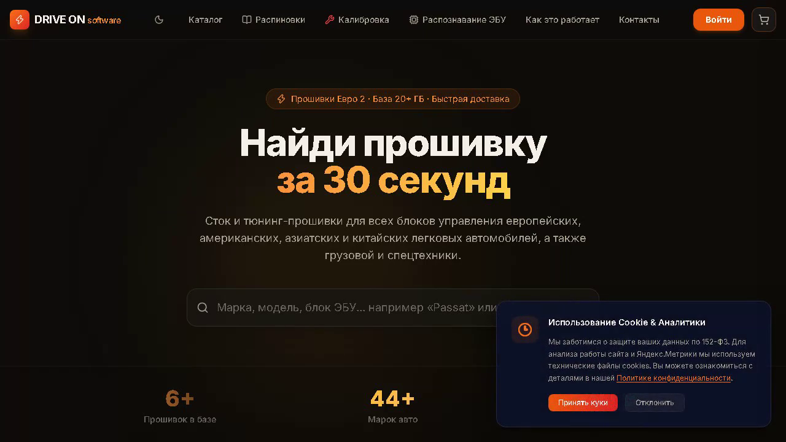
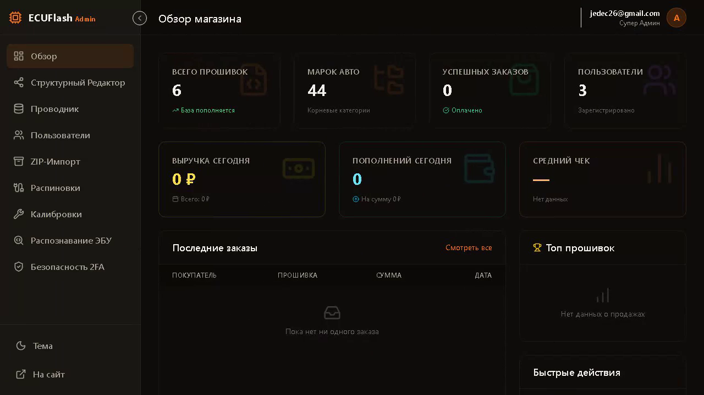
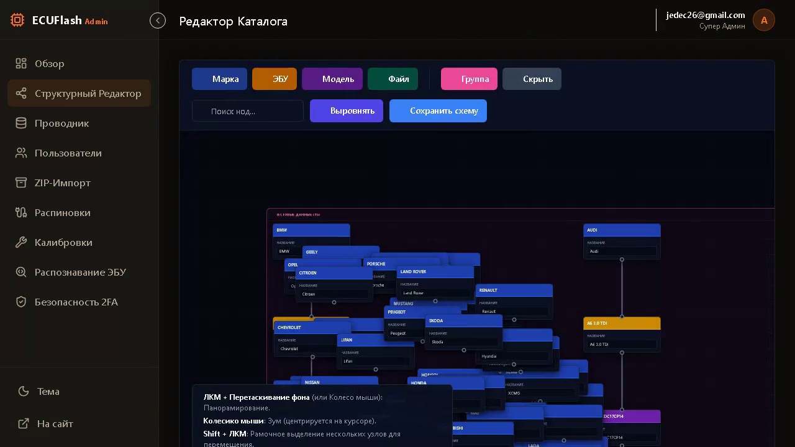
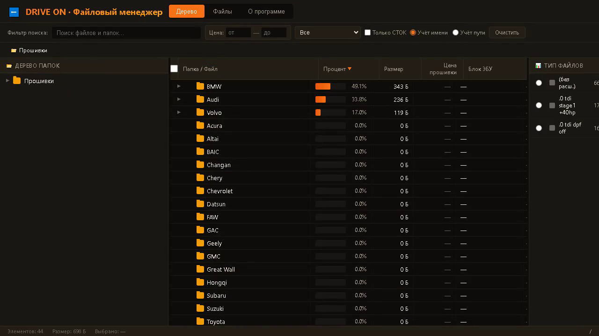
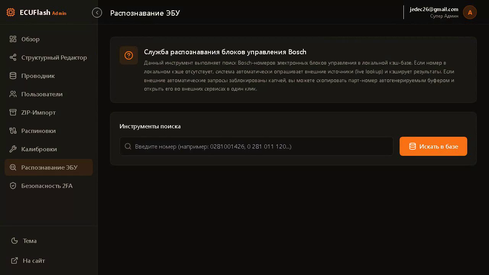
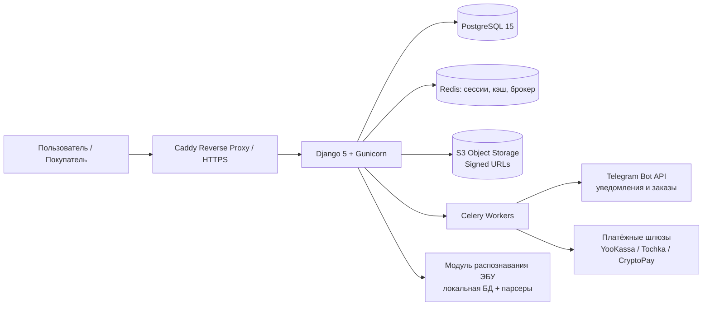

# 🚗 DRIVE ON — B2B/B2C-платформа цифровых автопрошивок и калибровок ЭБУ

> **Showcase-репозиторий (Commercial / Closed Source).**  
> Исходный код коммерческого проекта не публикуется. Здесь представлены архитектура, технологический стек, реализованные инженерные решения, скриншоты и видеодемонстрация работы системы.

---

## 🎬 Видеодемонстрация (27 сек)

> Демонстрация пользовательского пути (тёмная тема, cookie-баннер по 152-ФЗ, каталог) и кастомной панели администратора (аналитика, нодовый редактор, проводник БД, распознаватель ЭБУ, Django Jazzmin).

📹Смотреть демо-видео 

https://github.com/user-attachments/assets/0b6733e2-6fe7-4b84-bf68-4377771187c5

---

## 📸 Интерфейсы (Dark Mode)

### Витрина и каталог

### Кастомный дашборд администратора

### Интерактивный нодовый редактор каталога

### Проводник базы данных и массовое управление прошивками

### Сервис распознавания блоков управления (ЭБУ Bosch)

---

## 🏗 Архитектура системы

---

## ⚙️ Технологический стек и ключевые модули

### Backend & Хранение данных
- **Django 5.0 + Gunicorn** — монолитное веб-приложение с SSR, модулями `shop` (магазин, заказы, DRM, калибровки) и `bosch_ecu` (распознавание блоков управления).
- **PostgreSQL 15** — основная БД в продакшене (`dj-database-url`), локальная `SQLite` для изолированной разработки.
- **Redis + Celery** — асинхронная очередь задач (доставка прошивок, агрегированные дайджесты продаж, уведомления), хранение сессий (`cached_db`) и FSM-состояний Telegram-бота.
- **S3 (`django-storages` + `boto3`)** — хранение тяжёлых бинарных файлов прошивок в приватном бакете и выдача временных подписанных ссылок (`AWS_QUERYSTRING_AUTH = True`, TTL 3600 с).

### Frontend & UX
- **TailwindCSS + Alpine.js** — адаптивный интерфейс с переключением светлой/тёмной темы (`dos_theme`), корзиной в `localStorage` и интерактивным каталогом.
- **Кастомный нодовый редактор** — визуальный граф категорий и прошивок на SVG/HTML-холсте (масштабирование, панорамирование, редактирование связей).
- **Проводник БД и ZIP-импорт** — пакетная загрузка, перенос и редактирование позиций без входа в стандартную админку.

### Безопасность и соответствие 152-ФЗ
- **2FA / TOTP (`django-otp`) + кастомный `AdminGateMiddleware`** — дополнительный шлюз перед доступом к админ-панелям.
- **Защита от брутфорса (`django-axes`)** — блокировка после серии неудачных попыток входа.
- **Content Security Policy (`CSPMiddleware`)** — генерация `nonce` на каждый запрос и строгие директивы для скриптов/медиа.
- **Куки и оферта (152-ФЗ)** — баннер согласия на аналитику и `ConsentLog` с фиксацией версии оферты, IP и User-Agent при регистрации.
- **Изоляция контейнеров** — запуск в Docker под непривилегированным пользователем (`appuser`).

### Интеграции
- **Платёжные шлюзы:** YooKassa, Точка Банк, CryptoPay (webhook-обработчики с верификацией).
- **Telegram-бот (`pyTelegramBotAPI`):** мгновенные уведомления администраторов о заказах и заявках на индивидуальную калибровку, ежедневные/недельные дайджесты.
- **Распознаватель ЭБУ Bosch:** поиск по номеру блока с агрегацией данных из локальной базы и внешних источников.
